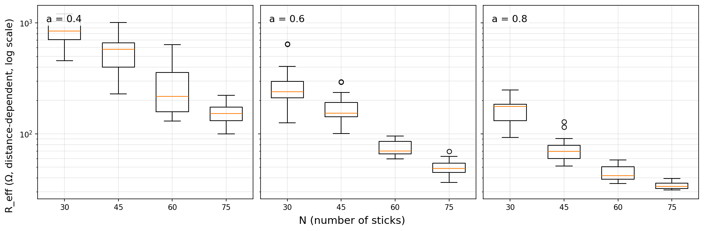
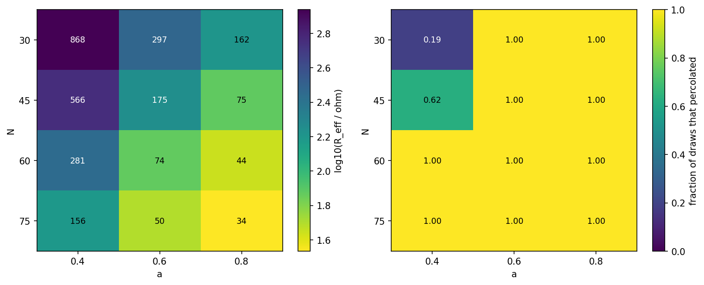
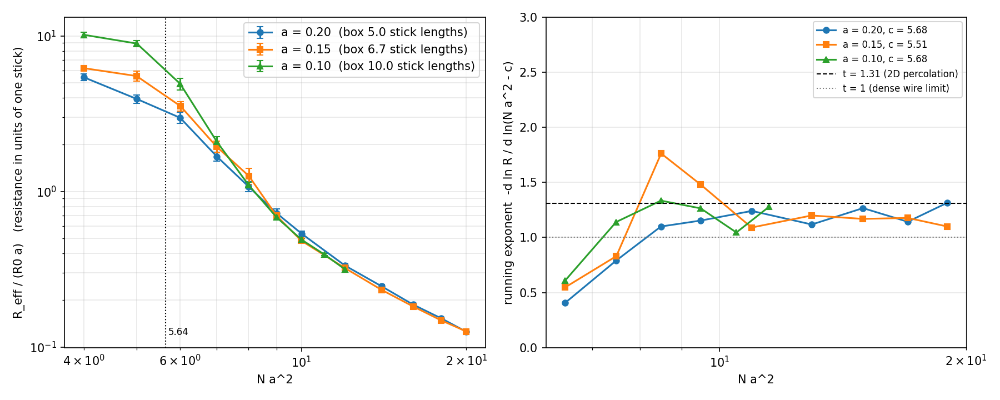
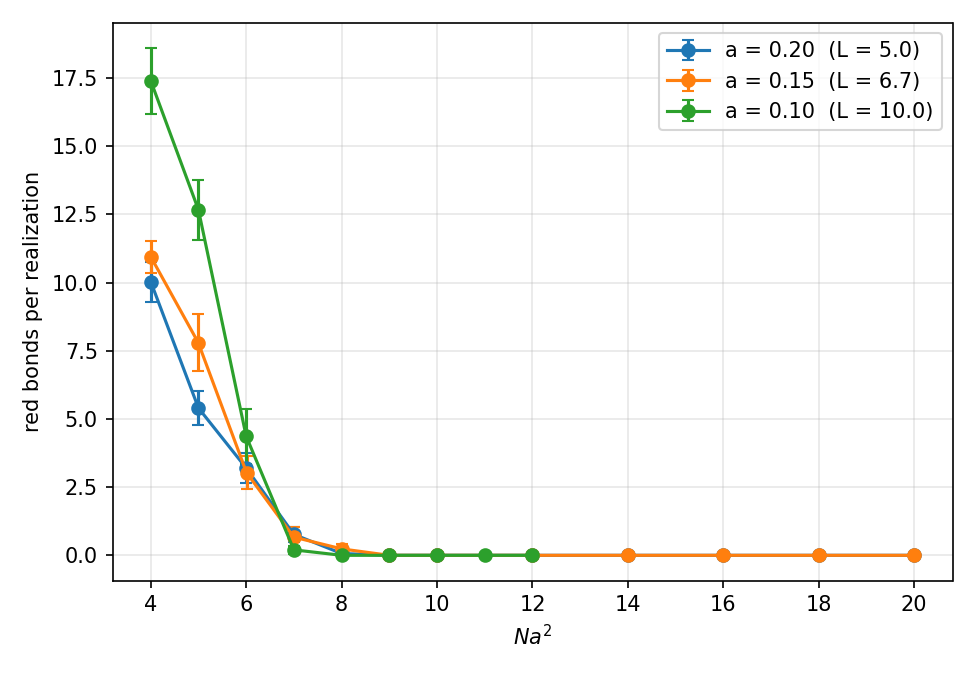
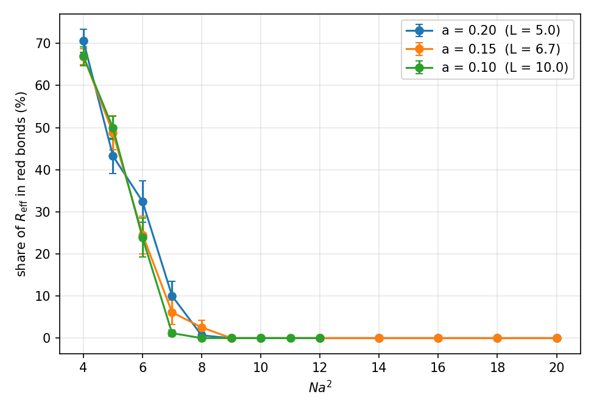
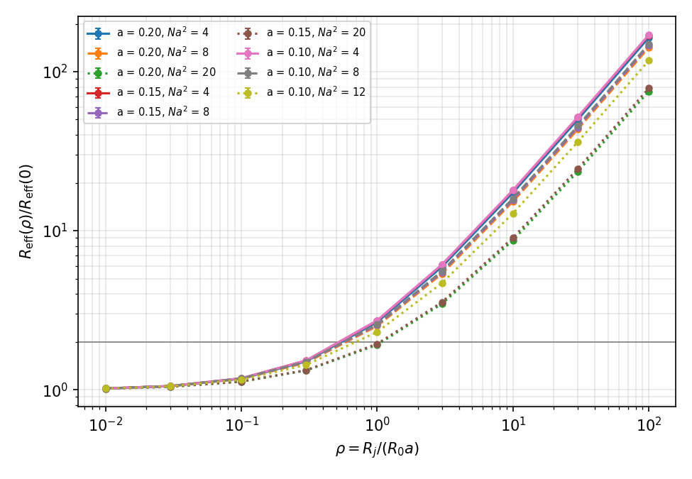
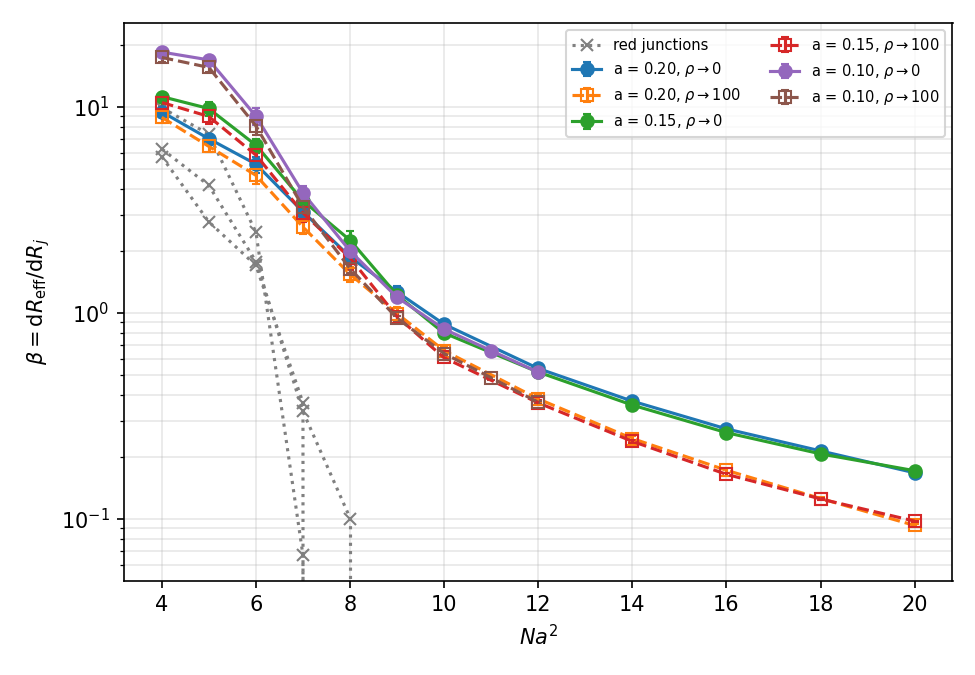
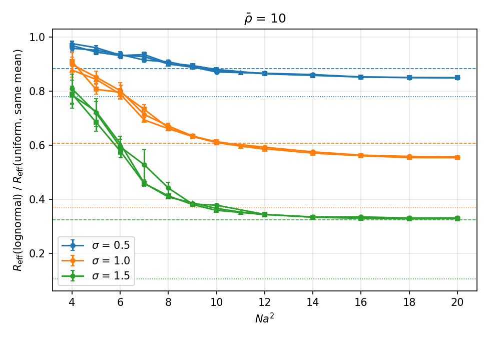
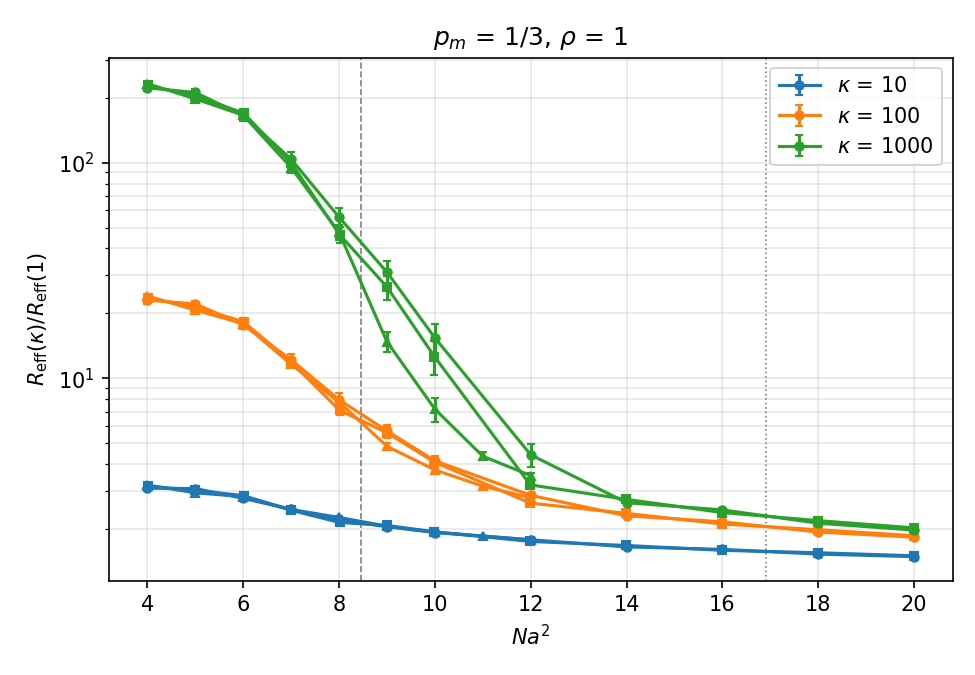
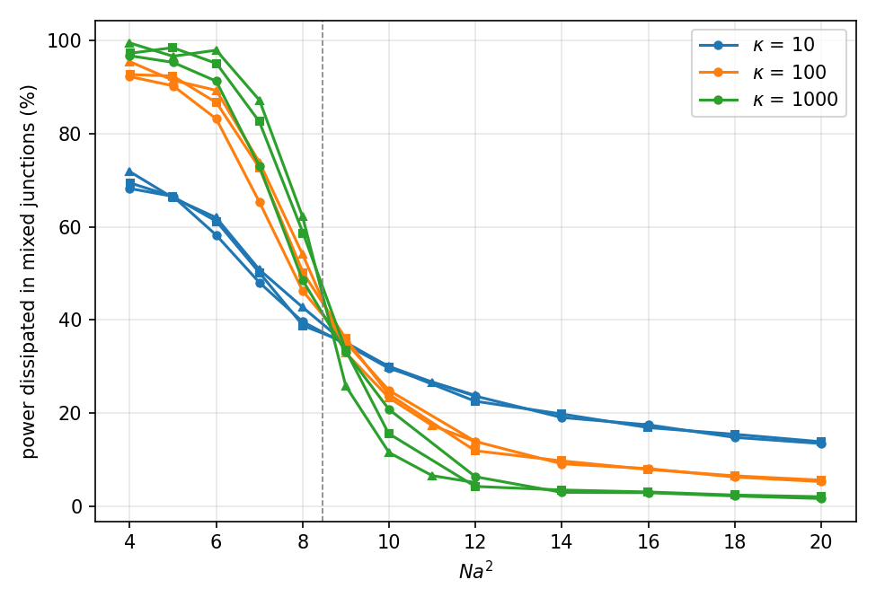

# Results

Every number on this page is traceable to a committed run under `experiments/` or a raw
results directory under `cluster/`, and every figure is a file in this repository. The
notebook or script that produced each result is named alongside it.

All results are from networks generated under the **clipping boundary rule** (2026-09-15):
stick centres are placed at uniform density in the box enlarged by `a/2` on every side and
each stick is clipped to the film, so `N` is a density per unit area and the film is not
depleted near its edges. The earlier runs, made under the rejection rule (sticks redrawn
until both endpoints fall inside the box), are kept under `*_reject` directories and
`experiments/exp_843`–`exp_869`, but are not cited here: the pooling and analysis scripts
read the boundary rule recorded in every summary and refuse to mix the two.

---

## 1. Forward problem in 2D: how `R_eff` depends on `N` and `a`

**Notebook:** [`effective_resistance_vs_N_a.ipynb`](../notebooks/effective_resistance_vs_N_a.ipynb)
**Runs:** `experiments/exp_883/` (baseline 4×3 grid), `experiments/exp_871/` (extended adaptive grid)

`R_eff` decreases monotonically with both the number of sticks and their length. More
sticks, or longer sticks, create more parallel conducting paths and shorter ones.





Baseline grid (15 percolating trials per cell, 400 draws budget, distance-dependent
model, `R0 = 1000 Ω` per unit length):

| N | a | mean R_eff (Ω) | median | std | percolation rate |
|---|---|---|---|---|---|
| 30 | 0.4 | 868.1 | 844.4 | 213.9 | 18.8% |
| 30 | 0.6 | 297.0 | 239.3 | 149.2 | 100% |
| 30 | 0.8 | 161.6 | 176.3 | 45.4 | 100% |
| 45 | 0.4 | 565.6 | 576.5 | 229.7 | 62.5% |
| 45 | 0.6 | 175.3 | 153.2 | 56.2 | 100% |
| 45 | 0.8 | 74.9 | 69.7 | 21.1 | 100% |
| 60 | 0.4 | 280.6 | 217.5 | 154.1 | 100% |
| 60 | 0.6 | 74.4 | 70.2 | 10.5 | 100% |
| 60 | 0.8 | 44.4 | 42.1 | 6.8 | 100% |
| 75 | 0.4 | 155.6 | 151.8 | 32.9 | 100% |
| 75 | 0.6 | 49.6 | 48.8 | 8.6 | 100% |
| 75 | 0.8 | 34.2 | 33.6 | 2.7 | 100% |

Every cell with `N·a² ≥ 10.8` percolates on every draw; `N = 45, a = 0.4` (`N·a² = 7.2`)
on 62.5% of them and `N = 30, a = 0.4` (`N·a² = 4.8`, below the `N·a² ≈ 5.6` threshold) on
18.8%. Compared with the rejection rule, the sparse cells got worse (`N = 30, a = 0.4`:
629 → 868 Ω, since sticks straddling an edge contribute only their inner part) and the
dense cells better (`N = 75, a = 0.8`: 47 → 34 Ω, since the density is now uniform up to
the electrodes).

### The adaptive grid

The impedance solve is a dense `O(n_nodes³)` operation and the node count grows roughly
as `N²a²`, so the sweep caps `N` per `a` to keep the estimated node count `0.5·N²a²`
under 3000, producing a ragged grid of 100 `(N, a)` pairs with 30 percolating trials
each and a stop at the first block of 200 consecutive non-percolating draws. Six pairs
never percolated (`N ≤ 80` at `a = 0.2`, `N = 20` at `a = 0.3`, all `N·a² ≤ 3.2`) and three
stopped short of 30 (`N = 90, a = 0.2` with 2; `N = 35, a = 0.3` with 1; `N = 20, a = 0.4`
with 6), for 2739 trials in all.

---

## 2. The `N·a²` collapse does not hold for `R_eff`

**Notebook:** [`inverse_N_a_from_R_eff.ipynb`](../notebooks/inverse_N_a_from_R_eff.ipynb), Section 3
**Pooled data:** `exp_883` + `exp_871`, 2919 individual percolating trials on 101 distinct
`(N, a)` points, `N·a²` from 3.15 to 84.7. Each distinct sweep enters once; the pooling
skips any summary that lacks `boundary: clip` or whose trial lists duplicate ones already
pooled.

| Model | Fitted form | R² |
|---|---|---|
| `N·a²` collapse | `R_eff ≈ 4806 · (N·a²)^(-1.271)` | 0.848 |
| **General** | **`R_eff ≈ 28254 · N^(-1.694) · a^(-2.459)`** | **0.904** |

A true collapse requires `p = 2q`. Here `p = -1.694` and `2q = -4.918`, a ratio of 0.34.
The collapse is rejected and the general fit is used for the inversion. Under the
rejection rule the same grids had given `N^(-1.514) · a^(-1.831)` with `R² = 0.823`.

### The percolation critical form

`R_eff = A · a^q · (N·a² − c)^(−t)`, fitted by nonlinear least squares in log space over
the same trials, 95% intervals from a bootstrap over the `(N, a)` cells:

| Fit | trials | q | t | c | R² |
|---|---|---|---|---|---|
| critical form, `c` free | 2919 | 0.99 [0.87, 1.14] | **1.44 [1.36, 1.51]** | 2.28 [1.80, 2.86] | **0.921** |
| critical form, `c = 5.64` (trials above it) | 2715 | 1.04 | 1.00 | fixed | 0.873 (general fit on the same trials: 0.884) |
| dense wire limit `R ∝ a/(N·a²)` | 2919 | 1 | 1 | 0 | 0.626 |
| general power law (above) | 2919 | | | | 0.904 |

`q = 0.99` is the `a¹` of the wire-limited model (under the rejection rule it had been
1.3, a finite-size correction from the depleted rim). The free threshold `c = 2.28` is
not a physical threshold: it absorbs the rounding of the transition in a finite box,
and the trials below `N·a² = 5` pull it down. The dense limit is not reached.

### The near-threshold sweep

**Script:** `cluster/run_critical_sweep_task.py` (33 tasks), `cluster/critical_sweep_fit.py`
**Raw data:** `cluster/critical_sweep_results/point_*.json` (990 realizations)

`N·a²` from 4 to 20 at `a = 0.20, 0.15, 0.10` (boxes 5, 6.7 and 10 stick lengths across),
30 percolating realizations per point.

- Half of the draws percolate at `N·a² = 5.68, 5.51, 5.68`: the infinite-system threshold
  `5.64` (Li & Zhang 2009; Mertens & Moore 2012). Under the rejection rule it had been
  4.6–4.9. At `N·a² = 4` the rate is 4.5%, 3.6%, 0.6% (sharpening with the box); at 5 it is
  25%, 26%, 17%.
- `R_eff/(R0·a)` coincides across the three boxes from `N·a² = 8` upward (within 6–17%,
  and 6–11% from 9), so `R ∝ R0·a · f(N·a²)` above the transition: `q = 1` confirmed
  directly. At `N·a² = 6` the boxes differ by 66%, at 7 by 25%.
- Running exponent (`c` at each box's half-percolation density): 0.4–0.6 across the
  first interval, 1.1–1.3 for `N·a²` from 7 to 20, no drift toward 1 by 20.
- Fits with `c` free run to the lower bound of the data (`c` between 0 and 0.9,
  `t` = 2.3–3.5) and describe the rounded region, not the critical behaviour. With
  `c = 5.64` and `N·a² ≥ 7`: `t = 1.10 [1.03, 1.18]`, `1.19 [1.13, 1.23]`, `1.19 [1.17, 1.25]`
  per box (`1.16, 1.19, 1.23` from `N·a² ≥ 8`); pooled `q = 0.98`, `t = 1.14`, `R² = 0.934`.
  Slightly below the 2D conductivity exponent 1.31; pinning `t` to a tenth needs larger
  boxes.



---

## 3. The inverse problem is underdetermined, and validated out of sample

**Notebook:** [`inverse_N_a_from_R_eff.ipynb`](../notebooks/inverse_N_a_from_R_eff.ipynb)
**Run:** `experiments/exp_884/`
**Raw data:** `cluster/validation_plan.json`, `cluster/validation_results/candidate_*.json` (Apuana, 2026-09-15)

Given a target `R_eff`, the fit constrains only a combination of `N` and `a`, so the
solution set is a **curve** in the `(N, a)` plane, not a point. Selecting a single geometry
off that curve needs an additional constraint from outside the model.

Seven targets at the 5th–95th percentiles of the per-point means, rounded to two
significant figures: 26, 31, 40, 73, 150, 460, 890 Ω. Four candidates per target at
`a = 0.2, 0.4, 0.7, 1.0`, read off the general-fit curve. A candidate is admitted only if
the curve's `N` is within the node budget (`0.5·N²a² ≤ 3000`) and at least 10; six are
infeasible and recorded as such (26 and 31 Ω at `a = 0.2, 0.4`, 40 Ω at `a = 0.2`: `N` of
211–641; 890 Ω at `a = 1.0`: `N = 8`), leaving **22 unique candidates**, 30 fresh networks
each (the 890 Ω, `a = 0.2` one reached only 4).

| Target | N | a | tag | achieved | error |
|---|---|---|---|---|---|
| 26 | 104 | 0.7 | sparse-ish | 27.0 | +3.9% |
| 26 | 62 | 1.0 | very-sparse | 31.4 | +20.9% |
| 31 | 94 | 0.7 | sparse-ish | 32.2 | +3.9% |
| 31 | 56 | 1.0 | very-sparse | 36.0 | +16.1% |
| 40 | 182 | 0.4 | compact-ish | 31.1 | −22.3% |
| 40 | 81 | 0.7 | sparse-ish | 38.5 | −3.7% |
| 40 | 48 | 1.0 | very-sparse | 42.5 | +6.2% |
| 73 | 348 | 0.2 | very-compact | 48.6 | −33.4% |
| 73 | 127 | 0.4 | compact-ish | 51.6 | −29.3% |
| 73 | 57 | 0.7 | sparse-ish | 62.3 | −14.7% |
| 73 | 34 | 1.0 | very-sparse | 68.9 | −5.6% |
| 150 | 228 | 0.2 | very-compact | 145.2 | −3.2% |
| 150 | 83 | 0.4 | compact-ish | 124.1 | −17.3% |
| 150 | 37 | 0.7 | sparse-ish | 123.5 | −17.7% |
| 150 | 22 | 1.0 | very-sparse | 152.0 | +1.3% |
| 460 | 118 | 0.2 | very-compact | 789.9 | +71.7% |
| 460 | 43 | 0.4 | compact-ish | 626.0 | +36.1% |
| 460 | 19 | 0.7 | sparse-ish | 534.3 | +16.1% |
| 460 | 11 | 1.0 | very-sparse | 532.8 | +15.8% |
| 890 | 80 | 0.2 | very-compact | 1073.9 (n = 4) | +20.7% |
| 890 | 29 | 0.4 | compact-ish | 914.9 | +2.8% |
| 890 | 13 | 0.7 | sparse-ish | 811.6 | −8.8% |

Median absolute error 15.9% over the 22; 19 within 30%. By tag: sparse-ish 9.8%,
very-sparse 11.0%, compact-ish 21.5%, very-compact 32.2% (mean absolute error). The two
worst rows (`N·a²` 4.7 and 6.9) sit at the percolation transition; over the 15 candidates
with `N·a² ≥ 10` the median is 15.8%, 14 within 30%, 11 within 20%, worst 33%. The
remaining errors are structured, not random: the general fit over-predicts by 15–28% at
`N·a²` 15–30 for `a` 0.4–0.6 (where the compact candidates of the middle targets sit)
and under-predicts near the threshold — the straight-line law misses the curvature the
critical form captures — and `N = 348` at `a = 0.2` and `N = 182` at `a = 0.4` lie beyond
the largest `N` sampled at those lengths (150).

A first clip-rule run of this validation was discarded: rounding targets to the nearest
ten made the 5th and 15th percentiles both 30 Ω, and capping `N` at the budget sent three
targets to the same `(387, 0.2)`, so four of its 28 rows were the same networks
(`cluster/validation_results_clip_dup30/`, kept for the record). The plan builder now
rejects coincident targets and duplicate candidates.

---

## 4. Film thickness `d` as a third parameter

**Notebook:** [`effective_resistance_vs_d.ipynb`](../notebooks/effective_resistance_vs_d.ipynb)
**Runs:** `experiments/exp_872/` (fixed `N = 70, a = 0.6` box sweep and robustness combinations), `experiments/exp_873/` (420-combination grid analysis)
**Raw data:** `cluster/effective_resistance_d_results/` (Apuana, 24 realizations per combination, stop at 500 consecutive non-percolating draws)

Sticks are 3D segments in a `1 × 1 × d` slab; two sticks are in contact when their
closest distance is at most 0.03. `N` is the expected number of sticks in the slab per
unit area of the film (volumetric density `N/d`) and is held fixed as `d` varies.

Fixed `N = 70, a = 0.6`, 12 percolating trials per `d`: mean `R_eff` rises from 203 Ω at
`d = 0.10` to 1490 Ω at `d = 1.0` while the percolation rate falls from 100% to 7%.

The 420-combination grid (10 values of `a`, 7 of `d`, 6 of `N` per `a`): 321
combinations reached 24/24, 20 percolated partially, 79 never percolated; the 341 with at
least one realization carry 7800 individual resistances. The non-percolating corner is
thin, short-stick films: 8/42 combinations percolate at `a = 0.2`, 21 at 0.3, 31 at 0.4,
34 at 0.5, 39–42 from 0.6 up.

Three-parameter power law over all 7800 realizations:

```
R_eff ≈ 8.64e5 · N^(-1.892) · a^(-2.634) · d^(0.804)      R² = 0.854
```

Standard errors 0.011, 0.016, 0.007; `t = 108` for the `d` exponent; `R² = 0.635` without
the `d` term. Thickness at fixed `N` dilutes the film: at `a = 0.2`, `N = 150` rises from
839 ± 43 Ω (`d = 0.10`) to 1121 ± 67 (0.15) and 1205 ± 62 (0.20) while the percolation rate
falls from 27% to 1.9%, and nothing percolates past `d = 0.2`.

**Constant-density control** (`cluster/density_control.py`, `figures/partA_constant_density_control.json`,
`N/d = 1500`, `a = 0.2`, 250 realizations each): 911 ± 19 Ω (`N = 150, d = 0.10`, rate 0.24),
551 ± 17 Ω (`225, 0.15`, rate 0.83), 293 ± 10 Ω (`300, 0.20`, rate 0.98). At fixed density
a thicker film conducts better, by a factor of 3.1 over a doubling of `d` (the fit
predicts `d^(-1.09)`, a factor 0.47; the measured 0.32 is steeper because the thinnest
combination sits at the transition). The onion curves of the same combinations
separate only from `r = 0.3` outward (16 standard errors at `r = 0.9`); at `r = 0.1` and
`0.2` the three films are within one standard error of each other.

---

## 5. Onion-curve shape separates geometries the scalar cannot

**Notebook:** [`r_eff_ij_vs_N_a_d.ipynb`](../notebooks/r_eff_ij_vs_N_a_d.ipynb)
**Run:** `experiments/exp_877/` (grouping, shape spread, ANOVA)
**Scripts:** `cluster/onion_tolerance_sweep.py` (CV and tolerance tables), `cluster/curve_inversion.py` (regression)
**Raw data:** `cluster/onion_grid_results/` (24 realizations per combination, with `per_realization_curves`), `cluster/preview_curves_results/`

### The protocol

Fix a reference node `i` on the source face; for every other node `j`, `R_eff(i, j) =
L⁺_ii + L⁺_jj − 2·L⁺_ij` from one pseudoinverse per network; average over the nodes in
shells of radius 0.1 to 0.9 (half-width 0.05). Validated against the per-pair direct
solve: max relative error `8.5e-13` (146 probes, 2D reference network) and `7.1e-13`
(152 probes, 3D).

Preview combinations (`cluster/preview_curves_results/`, 50 realizations each, `a = 0.2`):

| combination | rate | scalar R_eff | r = 0.1 | r = 0.9 | ratio |
|---|---|---|---|---|---|
| (150, 0.2, 0.10) | 22.0% | 1052 ± 48 | 150 ± 12 | 1281 ± 45 | 8.5 |
| (150, 0.2, 0.15) | 8.7% | 1167 ± 46 | 139 ± 10 | 1379 ± 46 | 9.9 |
| (125, 0.2, 0.10) | 4.8% | 1067 ± 31 | 137 ± 8 | 1209 ± 31 | 8.9 |

The outermost shell reads 13–22% above the whole-face scalar, as it must (one node
instead of a whole face). The scalar of (150, 0.2, 0.10) is 1052 ± 48 here, 911 ± 19 in the
250-realization density control and 839 ± 43 in the grid; the preview units reproduce bit
for bit when redrawn, so this is sampling spread at the transition, not a code difference.

### The test design

The onion grid mirrors the scalar grid (same 420 combinations, same seeds, same draw
order), so every combination yields the same networks in both; all 341 usable
combinations carry both observables. Combinations are sorted by scalar mean `R_eff` and
greedily grouped within a 15% relative tolerance, requiring different `(N, a)`; within a
group every individual realization's curve is normalized by its own value at the largest
shared shell, and a one-way ANOVA is run per shared shell with the triple as the factor
(triples with ≥ 3 realizations, groups with ≥ 2 such triples and ≥ 2 shared shells).

### Full grid, 24 realizations per point

32 groups cover 337 of the 341 combinations (sizes 3 to 37). Mean normalized-shape spread
per group: 0.009 (group 0) to 0.080 (group 31), mean 0.043.

| | |
|---|---|
| (group, shell) tests | 234 |
| Significant at `p < 0.05` | **81 (34.6%)** (≈ 5% expected under the null) |
| Bonferroni survivors (`α = 2.14e-4`) | **19** |
| Median / mean p | 0.176 / 0.259 |
| Groups with min p < 1e-2 | 19 of 32 |
| Groups with no significant shell | 8 of 32 |

Strongest groups: 7 (14 triples, min p `9.3e-9`, 7/8 shells), 5 (12, `1.7e-8`, 50%), 3
(13, `1.5e-6`, 62%), 10 (11, `1.9e-6`, 75%), 6 (6, `3.9e-6`, 62%), 2 (4, `6.7e-6`, 7/8),
25 (11, `1.2e-5`, 62%), 4 (10, `1.3e-4`, 38%).

Figures: `experiments/exp_877/partC_group_7_{raw,shape}.png` (strongest group) and
`partC_group_31_{raw,shape}.png` (most shape-divergent).

### Robustness of the 15% tolerance

Realization-to-realization coefficient of variation of the scalar within a combination
(334 combinations with ≥ 2 realizations): median 33.2%, IQR 21.6–47.4%, 90th percentile
61.1%, 88.9% above 15%. The matching uses means over 24 realizations, whose standard
error at the median CV is 6.8%, below the tolerance.

| tolerance | groups | tests | % sig. | Bonferroni | median p |
|---|---|---|---|---|---|
| 5% | 62 | 474 | 21.9% | 10 | 0.247 |
| 7.5% | 48 | 363 | 28.9% | 14 | 0.230 |
| 10% | 38 | 284 | 27.8% | 14 | 0.237 |
| 12.5% | 35 | 258 | 30.2% | 19 | 0.199 |
| 15% | 32 | 234 | 34.6% | 19 | 0.176 |
| 17.5% | 28 | 202 | 38.1% | 20 | 0.116 |
| 20% | 24 | 176 | 41.5% | 19 | 0.096 |
| 25% | 20 | 145 | 39.3% | 19 | 0.096 |
| 30% | 19 | 137 | 44.5% | 25 | 0.066 |

The fraction rises with the tolerance because a wider tolerance admits scalar
differences into the groups; at 5% it is still one test in five.

The earlier study (rejection rule, 6 realizations) had 19.2% significant and confirmed
the signal by boosting the five strongest groups to 50 realizations. Running the whole
regenerated grid at 24 makes the boost unnecessary; `run_onion_grid_boost_task.py` is
kept but feeds no result.

### Inverting `(N, a, d)` from the curve

`cluster/curve_inversion.py` → `cluster/onion_grid_results/curve_inversion_summary.json`.
Ridge on standardized log10 features, 10-fold CV grouped by combination (test
combinations never seen in training), targets log10 `N`, `a`, `d`.

| samples | features | R² (N, a, d) | RMSE log10 (N, a, d) |
|---|---|---|---|
| 5516 single realizations (315 combos) | scalar | 0.11 / 0.22 / 0.01 | 0.188 / 0.154 / 0.305 |
| | curve + scalar | 0.11 / 0.23 / 0.25 | 0.187 / 0.153 / 0.266 |
| 331 mean curves | scalar | 0.21 / 0.14 / 0.11 | 0.224 / 0.167 / 0.314 |
| | curve + scalar | 0.29 / 0.22 / 0.43 | 0.212 / 0.159 / 0.251 |
| | curve + scalar, kNN-5 | 0.30 / 0.18 / 0.68 | 0.211 / 0.163 / 0.188 |

Averaging `k` realizations (119 combinations with 24 complete realizations): the scalar's
scores stay at 0.05 / 0.21 / −0.02 for every `k`; curve + scalar takes `d` from 0.15
(`k = 1`) to 0.38 (3), 0.53 (6), 0.65 (12) and **0.76 (24)** while `N` and `a` stay at 0.04
and 0.21. The curve determines the film thickness, the scalar does not, and neither
separates `N` from `a` at fixed resistance. The rejection-rule grid had shown the curve
recovering `a` (R² 0.55 on single realizations); that was the depleted rim, one stick
length wide, read as a signal, and it disappeared with the change of rule.


---

## 6. What the pairwise resistance does and does not say about distance

**Scripts:** `cluster/probe_distance_figure.py`, `cluster/regenerate_preview_networks.py`, `cluster/probe_figures.py`
**Raw data:** `cluster/preview_curves_results/`, `cluster/preview_curves_decomposition.json`, `cluster/random_networks_results/` (supplement networks)

In the 3D preview networks the pairwise resistance is linear in probe separation
(power-law exponents 0.97–1.04; linear intercepts 38, −8, 10 Ω; a `√r` form only with
intercepts of −500 to −590 Ω; reduced χ² of a line through the origin 0.8, 0.6, 0.6), as in
a wire: the regenerated networks have 213, 122 and 133 nodes but a mean degree of only
2.7–2.8.

In the dense 2D supplementary networks (`N·a²` 13.8–20.2), anchored at the source face
(309 curves), the pooled curve rises from 72 ± 3 Ω to 259 ± 4 Ω (ratio 3.6, exponent 0.57)
with increments 39, 43, 26, 15, 17, 15, 11, 20 Ω: concave, then flat, with a small upturn at
the last shell. The parallel factor `d_ij/R_eff,ij` climbs from 2.5–3.0 at `l = 0.1` to
4.0–5.2 by `l ≈ 0.6–0.7`. The all-pairs local exponent runs 0.8–0.9 → 0.5–0.8 (mid-range)
→ 1.0–1.3 in the last two bins for the three densest combinations.

Node density by distance to the nearest edge is flat under the clipping rule (203 per
unit area in the outermost 0.05 band, 216–227 in the next five; under the rejection rule
it had been 7 vs 913). What changes at the edge is the node degree, 2.79 in the outermost
band against 3.3–3.6 inside: a stick cut by the edge is shorter and its crossings have
fewer continuations. That is the residual edge effect in the last shell and the last
bins; it is a property of a film cut from a deposit, not of the generator.

The `L⁺_ii + L⁺_jj − 2·L⁺_ij` decomposition was tried and set aside (a homogeneous chain
gives the same apparent saturation); tables in the thesis appendix, data in
`cluster/preview_curves_decomposition.json`.

---

## 7. The electrical backbone: red bonds and cut vertices from effective resistances

**Script:** `cluster/run_backbone_task.py` (33 tasks, Apuana 2026-09-17), `cluster/backbone_analysis.py`
**Raw data:** `cluster/backbone_results/point_*.json` (990 realizations, the near-threshold
sweep regenerated from its seeds and checked against `critical_sweep_results/` to 1e-9),
`cluster/backbone_results/backbone_summary.json`

The cut-edge and cut-vertex criteria of effective-resistance theory (Bennett et al. 2026),
restated for edges whose resistance is their length, read the percolation backbone off the
pairwise-resistance matrix: an edge is a bridge iff `R_eff,uv = r_uv`; a bridge is a red
bond iff `R_eff,su + r_uv + R_eff,vd = R_eff,sd`; a vertex is a cut vertex of the
source–drain backbone iff `R_eff,sb + R_eff,bd = R_eff,sd`. Each was cross-checked against
the current field (`|I_e| = I_total`) and against Tarjan bridges / articulation points on
every network: **990 networks, zero disagreements** at a relative tolerance of 1e-8. The
equalities are not fragile: a 5% margin on the current criterion returns the same edges,
and a 1% margin on the bypass ratio adds 0.1 edge per network.




| `a` | `N·a²` | pruned nodes | backbone nodes | dead edges | red bonds | share of `R_eff` | wire length share | cut vertices |
|---|---|---|---|---|---|---|---|---|
| 0.20 | 4 | 69 | 54 | 20% | 10.0 ± 0.7 | 71% | 22% | 13.4 |
| 0.15 | 4 | 97 | 74 | 21% | 10.9 ± 0.6 | 67% | 16% | 15.3 |
| 0.10 | 4 | 194 | 132 | 31% | 17.4 ± 1.2 | 67% | 14% | 25.5 |
| all | 7 | | | 9–13% | 0.2–0.8 | 1–10% | | 0.4–1.3 |
| all | ≥ 9 | | | < 3% | 0 | 0 | | 0 |

* At the threshold, 10–17 red bonds carry two thirds of `R_eff` in a sixth of the wire;
  the share is the same in the three boxes, the count grows with the box. The
  size-scaling slope of the count is 0.82 [0.53, 1.10] at `N·a² = 4` and 1.23 [0.83, 1.66]
  at 5 — consistent with `1/ν = 3/4`, not a determination (three boxes spanning a factor
  of two in `L`).
* Red bonds fall below one per network at `N·a² = 7`, one grid step above the
  half-percolation density 5.5–5.7, and are zero from 9. `N·a² = 8`, the density from
  which `R_eff/(R0·a)` collapses across the boxes (section 2), is the first at which a
  typical network has none; the running exponent of 0.4–0.6 between the first two points
  of the critical sweep is the regime where the network is a chain of red bonds.
* Cut vertices exceed red bonds by a factor 1.3–1.5: red bonds come in runs along single
  sticks.
* **The degree-based pruning is not the backbone.** 20–31% of the pruned graph's edges
  carry no current at the threshold (loops and blobs hung on the backbone by a single
  edge, which have no degree-one node), ~5% at `N·a² = 8`, < 1% from 12, 0.1% at 20. No
  resistance is affected; node counts quoted near the threshold are those of the pruned
  graph. The pruned graph keeps one to five bridges above `N·a² = 8` while the backbone
  has none — the edges by which the dead parts hang.
* The bypass ratio `R_eff,uv / r_uv` (the Spielman–Srivastava leverage score) has a
  spike at 1 near the threshold and moves down with density; its mean falls from
  0.71–0.72 to 0.54, box-independent. Red bonds sit in the bulk of the film and are
  depleted within a stick length of the electrodes.

---

## 8. Junction resistance: from the wire-limited to the junction-limited network

**Module:** `utils/junction_model.py`
**Scripts:** `cluster/run_junction_task.py`, `cluster/run_junction_variants_task.py` (33 tasks each, Apuana 2026-09-18), `cluster/junction_analysis.py`, `cluster/junction_variants_analysis.py`
**Notebook:** [`junction_resistance.ipynb`](../notebooks/junction_resistance.ipynb) (hand case, validation, laptop-scale preview of the three rules)
**Raw data:** `cluster/junction_results/`, `cluster/junction_variants_results/` (990 realizations each, same networks as sections 2 and 7), with `*_summary.json`

Every crossing of sticks `i` and `j` becomes two nodes joined by a junction edge of
resistance `R_j`; the segments keep `R0·L` and run between the copies on their own stick;
terminals are ideal. The parameter is `ρ = R_j / (R0·a)`, junction over one stick.
Contracting the junctions reproduces the stored wire-limited `R_eff` to 6e-13; every task
checks `ρ = 0` against the stored value to 1e-9 before measuring. Solves are sparse (≈1 ms
at 2000 nodes).

**Uniform `R_j`** (`ρ ∈ {0, 0.01, 0.03, 0.1, 0.3, 1, 3, 10, 30, 100}`):




| `N·a²` (a = 0.20) | `R_eff(0)` | `R(1)/R(0)` | `R(100)/R(0)` | `ρ*` (doubling) | `β` at ρ→0 | `β` at ρ→100 | red seg. | red jun. |
|---|---|---|---|---|---|---|---|---|
| 4 | 1084 Ω | 2.66 | 164 | 0.52 | 9.45 | 8.90 | 9.9 | 5.7 |
| 8 | 215 Ω | 2.51 | 142 | 0.56 | 1.87 | 1.54 | 0.1 | 0.0 |
| 12 | 67 Ω | 2.28 | 115 | 0.68 | 0.54 | 0.38 | 0 | 0 |
| 20 | 25 Ω | 1.91 | 75 | 1.07 | 0.17 | 0.09 | 0 | 0 |

* **The crossover depends on `N·a²` and `ρ` alone.** `ρ*` = 0.52 / 0.49 / 0.49 at
  `N·a² = 4` and 0.68 / 0.68 / 0.66 at 12 in the three boxes; the curves coincide at every
  common density. A junction costing half a stick doubles the resistance at the threshold,
  one costing a stick doubles it at `N·a² = 20`.
* **Additivity (Benda et al.) holds near the threshold and fails in dense networks.** The
  slope `β = dR_eff/dR_j` drifts 6% over four decades of `ρ` at the threshold (9–18
  junctions in series depending on the box) and halves at `N·a² = 20` (0.17 → 0.09: ten
  routes share each junction), in the concave direction Rayleigh's law allows.
* Exponent of `R_eff` in `N·a²` over 8–20: −2.30 / −2.37 at `ρ = 0`, −3.00 / −3.05 at
  `ρ = 100` (a = 0.20 / 0.15) — the junction-limited network gains a power of density;
  both still carry the critical contribution.
* **Red junctions** are the cut vertices at which the current changes stick: 5.7 / 6.2 /
  9.9 of the 13.4 / 15.3 / 25.5 cut vertices, two fifths. Topological (independent of
  `ρ`). They hold 34–37% of `R_eff` at `ρ = 1` and 55–60% at `ρ = 100`, more than the red
  segments from `ρ ≥ 3`; all junctions dissipate 61–62% of the power at `ρ = 1`, 99% at 100.

**Lognormal `R_j` at fixed arithmetic mean** (`ρ̄ ∈ {0.1, 1, 10}`, `σ ∈ {0.5, 1, 1.5}`, 5 draws per network):



* At `ρ̄ = 0.1` the spread changes `R_eff` by < 5%; at the threshold with `ρ̄ ≤ 1` the
  ratio to the uniform network stays at 0.9–1 (a chain sees the sum).
* In dense networks (`N·a² ≥ 12`) the ratio saturates, box-independent, at
  **0.856 / 0.569 / 0.334** for `σ` = 0.5 / 1 / 1.5 at `ρ̄ = 10`, against
  `exp(−σ²/2)` = 0.882 / 0.607 / 0.325 (the geometric over the arithmetic mean) and
  `exp(−σ²)` = 0.78 / 0.37 / 0.11 (junctions in parallel). **A dense junction-limited
  network sees the median junction, not the mean.**

**Metallic / semiconducting sticks** (`p_m = 1/3`, `ρ = 1`, mixed junctions `κ ∈ {10, 100, 1000}` times more resistive, 5 assignments per network):




| `N·a²` | `R(κ=1000)/R(1)` | mixed-junction dissipation |
|---|---|---|
| 4 | 222–232 | 97–100% |
| 8 | 46–56 | 49–62% |
| 9 | 15–31 | 26–33% |
| 12 | 3.2–4.4 | 4–6% |
| 20 | 2.0 | 2% |

* 44% of the junctions are mixed. Below the threshold of the semiconducting sub-network
  (`⅔·N·a² = 5.64`, i.e. `N·a² ≈ 8.5`) every route crosses one and `R_eff ∝ κ`; above
  it the current abandons the mixed junctions. At `N·a² = 20` the film with an
  effectively open barrier is twice the `κ = 1` film — the semiconducting sub-network at
  two thirds of the density. The metallic sub-network (`N·a² ≈ 17`) never percolates
  within the sweep. Box-independent.

---

## Provenance of the key runs

| Run | Contents | Produced by |
|---|---|---|
| `experiments/exp_883/` | 2D baseline 4×3 `(N, a)` sweep, clip rule | `effective_resistance_vs_N_a.ipynb` Part A |
| `experiments/exp_871/` | 2D extended adaptive `(N, a)` grid, clip rule (from `cluster/experiments_clip/`) | `effective_resistance_vs_N_a.ipynb` Part B (Apuana) |
| `experiments/exp_872/` | Fixed-`(N, a)` thickness sweep and robustness combinations | `effective_resistance_vs_d.ipynb` Parts A–B |
| `experiments/exp_873/` | 420-combination scalar `(N, a, d)` grid analysis and three-parameter fit | `effective_resistance_vs_d.ipynb` Part C |
| `experiments/exp_876/` | Reference network, probes, onion protocol validation, 5-seed monotonicity check | `multimeter_r_eff.ipynb` |
| `experiments/exp_877/` | Onion grid analysis: 32 groups, shape spread, ANOVA | `r_eff_ij_vs_N_a_d.ipynb` |
| `experiments/exp_884/` | Clip-rule 2D fits (power laws, critical form with bootstrap), solution curves, the 22-candidate validation loaded from `cluster/validation_results/` (`exp_878`–`exp_884` are earlier executions of the same notebook, superseded when the figure titles were removed) | `inverse_N_a_from_R_eff.ipynb` |
| `cluster/*_results/` | Raw cluster outputs (scalar grid, onion grid, critical sweep, preview curves, supplement networks, robustness batch, backbone, junction, junction variants) | task scripts in `cluster/README.md` |
| `figures/backbone/`, `figures/junction/` | Figures of sections 7 and 8, written by the analysis scripts with `--figures` | `cluster/backbone_analysis.py`, `cluster/junction_analysis.py`, `cluster/junction_variants_analysis.py` |
| `cluster/*_results_reject/`, `experiments/exp_843`–`exp_869` | Rejection-rule runs, kept for comparison only | — |

`exp_874` and `exp_875` are executions of the onion and multimeter notebooks superseded
by `exp_877` and `exp_876` (same data; the later runs only changed which groups are drawn
as separate panels and skipped the interactive widget cell).

---

## Open items

1. The critical window in boxes of up to 10 stick lengths is a handful of points wide;
   a sparse solver and larger boxes are needed to pin `t` to a tenth.
2. The curve-based inversion recovers `d` and its score was still rising at 24 averaged
   realizations; neither observable separates `N` from `a` at fixed resistance. Several
   curves per network, anchored inside the film, are the next thing to try.
3. ~~The contact model places one node per contact; a richer treatment would use two nodes
   joined by a junction resistance.~~ Done for 2D in section 8 (`utils/junction_model.py`).
   Still open: the same extension for the 3D contact model, where the stored
   closest-approach distance per contact could set a tunneling-type `R_j`; the dense
   limit beyond `N·a² = 20` (the junction-limited exponent is −3.0 there, the dense
   expectation is −2); a separate resistance for semiconducting sticks; the electrode–stick
   contact resistance; and a junction capacitance for an AC impedance spectrum.
4. Periodic boundaries transverse to the current would remove the two side edges and the
   residual degree drop of section 6.
5. The degree-based pruning leaves current-free loops and blobs (section 7). Any use of the
   pruned graph *as* the backbone (node counts, sizes) should take the backbone from the
   current field or the electrical criteria instead.
6. The red-bond count scales with the box as `L^0.8–1.2` from three boxes; the `L^{3/4}`
   test needs the sparse solver of item 1.
