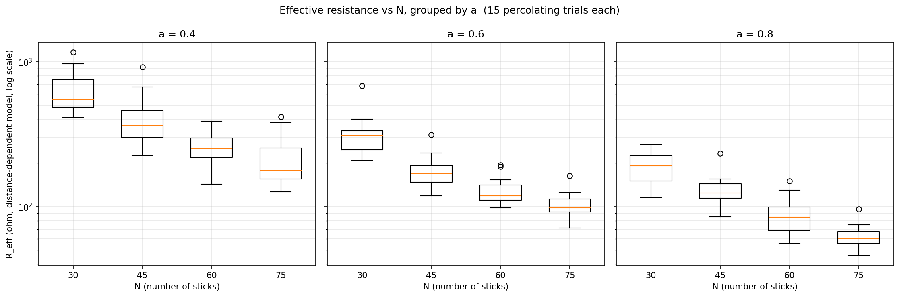
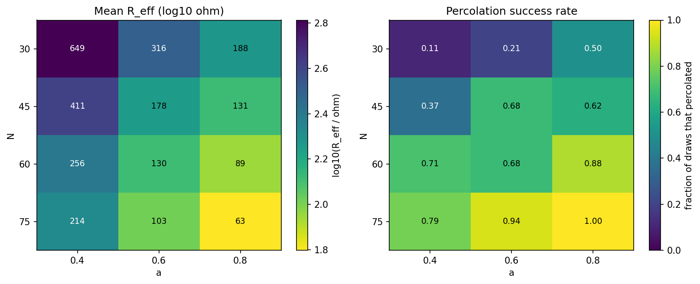
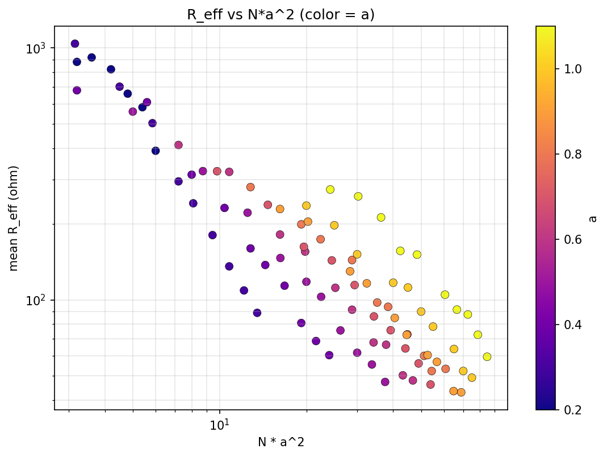
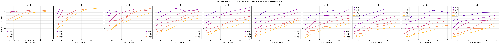
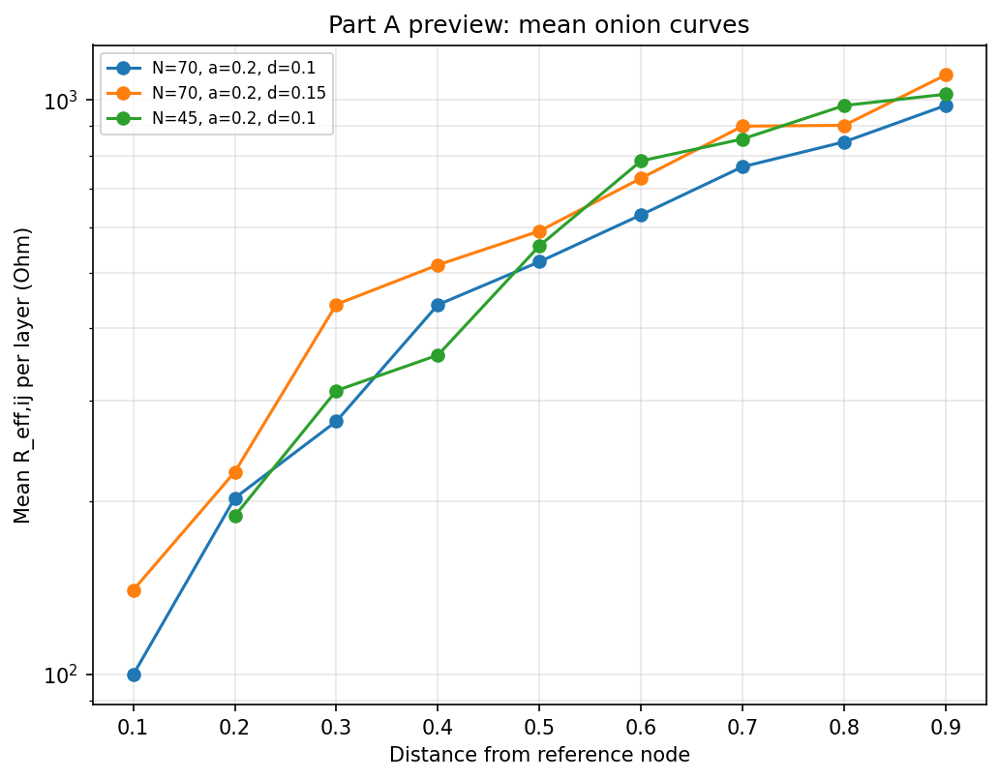
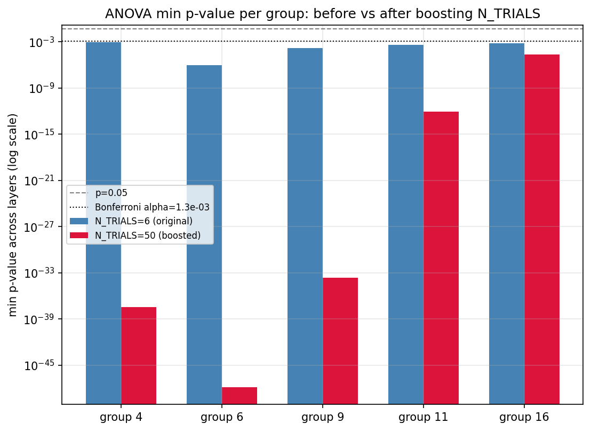

# Results

Every number on this page is traceable to a committed run under `experiments/`, and every
figure is a file in this repository. The notebook that produced each result is named
alongside it.

---

## 1. Forward problem in 2D: how `R_eff` depends on `N` and `a`

**Notebook:** [`effective_resistance_vs_N_a.ipynb`](../notebooks/effective_resistance_vs_N_a.ipynb)
**Runs:** `experiments/exp_813/` (baseline 4×3 grid), `experiments/exp_814/` (extended adaptive grid)

`R_eff` decreases monotonically with both the number of sticks and their length. More
sticks, or longer sticks, create more parallel conducting paths and shorter ones.





The percolation success rate collapses for small `N·a²`, as it must: the 2D stick
percolation threshold under the excluded-area criterion sits near `N·a² ≈ 5.6`, so a
combination like `N = 30, a = 0.4` (`N·a² = 4.8`) percolates only rarely. The `R_eff`
values recorded there come from atypical, close-to-minimal conducting paths, which is
expected behaviour near threshold rather than a defect.

### The adaptive grid

A naive rectangular sweep up to `N = 150, a = 1.0` is not affordable. The impedance solve
is a dense `O(n_nodes³)` operation and the node count itself grows roughly as `N²a²`.
Direct benchmarks:

| N | a | nodes | time per draw |
|---|---|---|---|
| 110 | 0.6 | 2177 | 2.7 s |
| 110 | 1.0 | 4458 | 20.1 s |
| 150 | 0.8 | 6430 | 48.5 s |
| 150 | 1.0 | 8235 | 97 s |

Dense networks also percolate on nearly every draw, so every trial pays the full cost. The
sweep therefore caps `N` per `a` so the estimated node count stays inside a fixed budget,
producing a ragged rather than rectangular grid.

---

## 2. The `N·a²` collapse does not hold for `R_eff`

**Notebook:** [`inverse_N_a_from_R_eff.ipynb`](../notebooks/inverse_N_a_from_R_eff.ipynb)

The excluded-area parameter `N·a²` is well justified for the percolation *threshold*.
Nothing guarantees that `R_eff` away from the threshold collapses onto the same variable,
so both forms were fitted on the same pooled data (2835 individual percolating trials, not
per-cell means, so cells with more trials carry proportionally more weight):

| Form | Fit | R² |
|---|---|---|
| Constrained to `N·a²` | `R_eff ≈ 2178.9 · (N·a²)^(-0.920)` | 0.776 |
| **General** | **`R_eff ≈ 10246.4 · N^(-1.283) · a^(-1.746)`** | **0.848** |

A true collapse onto `N·a²` requires `p = 2q`. Here `p = -1.283` and `2q = -3.491`, a ratio
of **0.367** rather than 1.0. The collapse is rejected, and the general fit is used for
the inversion.



This matters beyond bookkeeping: the temptation to reuse a threshold-derived scaling
variable for a transport quantity is exactly the kind of assumption that quietly
invalidates an inversion, and it is checked here rather than inherited.

---

## 3. The inverse problem is underdetermined

**Notebook:** [`inverse_N_a_from_R_eff.ipynb`](../notebooks/inverse_N_a_from_R_eff.ipynb)

Given a target `R_eff`, the fit constrains only a combination of `N` and `a`, so the
solution set is a **curve** in the `(N, a)` plane, not a point. Many short sticks behave
much like fewer long ones. Selecting a single geometry off that curve needs an additional
constraint from outside the model, such as a limit on how many sticks can be deposited or
how long they can be.

The inversion is validated out of sample: for each of seven target resistances (drawn from
the 5th through 95th percentile of the measured range, so the check interpolates rather
than extrapolates), four candidate `(N, a)` pairs spanning compact to sparse geometries
are taken off the solution curve, and brand-new random networks are drawn at those values.
These are fresh draws, not points reused from the fit.

---

## 4. Film thickness `d` as a third parameter

**Notebook:** [`effective_resistance_vs_d.ipynb`](../notebooks/effective_resistance_vs_d.ipynb)
**Run:** `experiments/exp_829/` (420-combination `(N, a, d)` grid, Apuana)

Confining the sticks to a slab `[0,1] × [0,1] × [0,d]` instead of the unit cube adds
thickness as a genuine third parameter.



`R_eff` **rises** monotonically with `d`, and the percolation success rate falls, across
every `(N, a)` baseline tested.

**The modelling choice behind that sign, stated explicitly.** `N` is held fixed as `d`
varies, so a thinner film packs the *same* sticks into a *smaller* volume. Volumetric
density is `N / (1 · 1 · d)`, so a larger `d` spreads the same material thinner, giving
fewer contacts and longer current paths. A fabrication perspective would more often hold
the **areal** density fixed, letting `N` grow with `d`, which deposits strictly more
material for a thicker film and is expected to show the opposite trend. That coupled sweep
is a natural follow-up and is deliberately not mixed into this single-variable slice.

Two limits recover known cases: `d = 1` is exactly the isotropic unit cube of
`percolation_3d.ipynb`, and `d` approaching zero is the direction of the 2D thin-sheet
pipeline.

The grid is adaptive along both axes, since shrinking `d` also increases the node count at
fixed `N` and `a`. The cap is fitted from direct benchmark timings:

```
n_nodes ≈ 0.0016 · N^2.66 · a^2.05 · d^(-0.60)
```

The worst uncapped corner (`N = 150, a = 1.0, d = 0.1`) did not finish in several minutes
locally, against a few seconds per draw everywhere the cap holds.

Because the scalar inversion in section 3 never used `d` at all, adding this third
parameter makes an already underdetermined problem strictly worse.

---

## 5. Main result: onion-curve shape separates geometries the scalar cannot

**Notebook:** [`r_eff_ij_vs_N_a_d.ipynb`](../notebooks/r_eff_ij_vs_N_a_d.ipynb)
**Protocol:** [`multimeter_r_eff.ipynb`](../notebooks/multimeter_r_eff.ipynb)
**Run:** `experiments/exp_840/`
**Raw data:** `cluster/onion_grid_results/`, `cluster/onion_grid_boost_results/`

### The protocol

Rather than a single source-to-drain number, the **onion-layer protocol** picks a
reference node and measures `R_eff(reference, j)` outward through concentric distance
shells (`0.1, 0.2, 0.3, …`), producing a curve instead of a scalar. This avoids probing
all `O(n²)` node pairs while still sampling how resistance grows with distance through the
network.

Computing it naively would need one dense solve per probed pair. Using the Laplacian
pseudoinverse identity instead costs **one decomposition per network**, after which every
pair is a cheap quadratic form. Both paths are verified to agree to numerical precision.



### The test design

The question is not whether onion curves differ in general, since curves with different
overall resistance obviously do. It is whether they differ **among geometries the scalar
already fails to separate**.

So `(N, a, d)` triples are grouped when their *scalar* `R_eff` agrees within 15% while
their `(N, a)` differ. Of the 420 grid points, 355 carry both a scalar resistance and a
non-empty onion curve, and those yield **30 matched groups**. Twenty-nine of the groups
have enough shared shells to test, giving 214 group-and-shell tests in total. Every curve
is normalized by its own value at the largest shared shell, so overall amplitude is
divided out and only shape remains. Then, per group and per shell, a
one-way ANOVA treats the triple as the grouping variable and the realization as the
replicate.

Working on individual realization curves rather than pre-averaged means is deliberate. An
earlier version of this analysis compared the spread of group *means*, each already
averaged over realizations, against *raw* single-realization noise, without the `√n`
correction that averaging provides. That comparison is not like for like, it undercounted
the signal, and it produced a false negative. The corrected test uses the per-realization
curves directly, so no manual variance correction is needed. The reference shell is
excluded because normalization forces it to exactly 1.0 with zero variance.

### Full grid, 6 realizations per point

| Quantity | Value |
|---|---|
| Tests performed | 214 |
| Significant at `p < 0.05` | **39 (18.2%)** |
| Expected by chance | ~5% |
| Surviving Bonferroni (`α = 2.3e-4`) | 2 |
| Median p | 0.342 |

Real but partial. Roughly three and a half times the chance rate, concentrated in a
handful of groups, with most groups showing nothing yet.

### Boosted rerun, 50 realizations

The five strongest groups (4, 6, 9, 11, 16, spanning 69 unique triples) were rerun at 50
realizations. Because the rerun reuses the same `stable_seed()` values, the first 6
realizations per combination are byte-identical to the original data (verified directly,
maximum absolute difference 0.0). This is a strict extension of the same draws, not an
independent resample.

| Group | Triples | Significant shells at n=6 | at n=50 | min p at n=6 | min p at n=50 |
|---|---|---|---|---|---|
| 4 | 14 | 25% | **100%** | 9.1e-4 | 3.3e-38 |
| 6 | 12 | 37.5% | **100%** | 9.2e-7 | 1.4e-48 |
| 9 | 14 | 37.5% | **100%** | 1.6e-4 | 2.3e-34 |
| 11 | 16 | 75% | **100%** | 4.0e-4 | 9.1e-13 |
| 16 | 12 → 13 | 25% | 37.5% | 6.8e-4 | 2.3e-5 |

Pooled over the boosted groups: **35 of 40 tests significant (87.5%), 31 surviving
Bonferroni correction**, against 2 of 214 across the whole grid at 6 realizations.



Per-group curve comparisons for all 30 groups are committed as
`experiments/exp_840/partC_group_*_shape_comparison.png`.

### Reading this honestly

Four of the five boosted groups go to 100% of shells significant, with p-values falling by
thirty or more orders of magnitude. That is the behaviour expected of a real effect
observed with more samples: ANOVA power grows with sample size at fixed effect size.

**Group 16 does not follow.** It reaches only 37.5% even at 50 realizations. Since it was
selected *because* it looked strong at 6 realizations, the most likely reading is that its
original ranking was partly a lucky draw and the underlying effect there is genuinely
marginal. This is reported rather than dropped: a selected-then-boosted group that fails
to sharpen is exactly the check that guards against selecting on noise, and it only works
as a guard if the failures are published alongside the successes.

### Conclusion

The shape of the onion-layer resistance curve carries real, statistically detectable
information about `(N, a, d)` that the scalar effective resistance collapses away. A
richer probe protocol therefore constrains the inverse problem in a way that a
single-number measurement cannot.

---

## Provenance of the key runs

| Run | Contents | Produced by |
|---|---|---|
| `experiments/exp_813/` | 2D baseline 4×3 `(N, a)` sweep | `effective_resistance_vs_N_a.ipynb` Part A |
| `experiments/exp_814/` | 2D extended adaptive `(N, a)` grid | `effective_resistance_vs_N_a.ipynb` Part B |
| `experiments/exp_829/` | 420-combination scalar `(N, a, d)` grid | `effective_resistance_vs_d.ipynb` Part C |
| `experiments/exp_840/` | Onion grid, matched-group ANOVA, boosted rerun | `r_eff_ij_vs_N_a_d.ipynb` |

`exp_813` and `exp_814` were executed on Apuana, where they were written as `exp_1` and
`exp_2` because that cluster's `experiments/` directory was empty at the time. They were
renumbered when synced back, to avoid colliding with unrelated local runs of the same
number. The `Results directory: .../exp_1` lines printed in those notebooks' saved outputs
are the accurate historical record of what ran on the cluster, and no longer match where
the files now live.

`r_eff_ij_vs_N_a_d.ipynb` was re-executed several times on 2026-08-24 while the analysis
was being corrected, leaving `exp_835` through `exp_840`. **`exp_840` is the canonical
run**: it is the notebook's current saved state and the most complete output. `exp_838`
holds byte-identical statistics from an earlier execution the same day and is kept as a
cross-check. The earlier folders predate the corrected ANOVA and should not be used.

---

## Open items

Carried forward deliberately rather than silently closed:

1. The power-law fit of `R_eff(N, a, d)` including a fitted `d` exponent has not been
   quantified. Section 4 establishes the direction of the dependence, not its exponent.
2. Section 5 pairs 355 combinations, against 356 that carry a non-null scalar resistance.
   The small discrepancy is recorded but has not been traced to its cause.
3. The 15% matching tolerance for grouping is a reasonable first cut, not a validated
   choice. With more data it would be worth being stricter about what counts as matched.
4. The contact model places one node per contact. A physically richer treatment would use
   two nodes joined by a junction resistance, as in tunneling models for fiber composites.
   The real closest-approach distance is already stored per contact, so no geometry would
   need recomputing.
